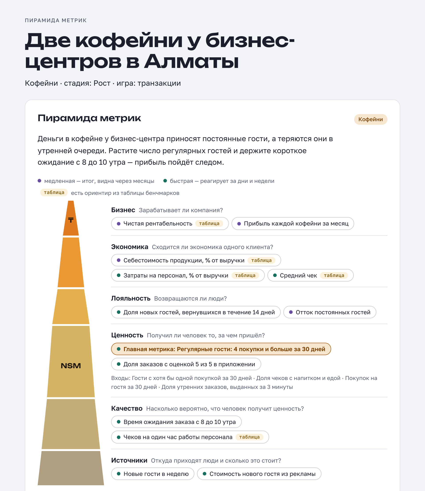
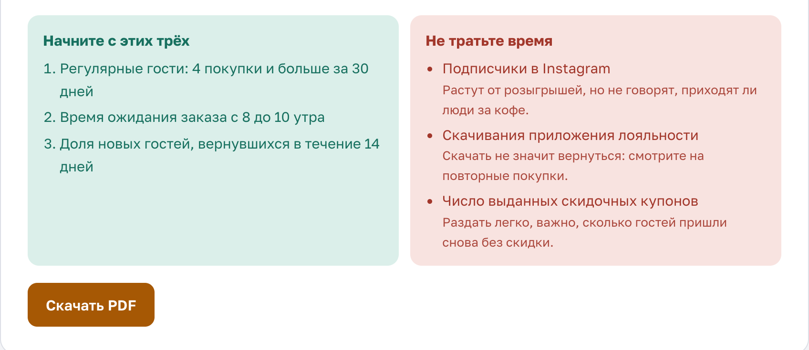

# metrics-advisor

**Подсказывает владельцу бизнеса, на какие цифры смотреть каждую неделю.**

Вы в двух словах описываете свой бизнес, а получаете 9–15 показателей. Для каждого показано, как его считать и какая норма в вашей отрасли. Отдельно выделены три показателя, которые стоит начать считать на этой неделе, и три, на которые не стоит тратить время.

Это дополнение (skill) для [Claude Code](https://claude.com/claude-code). После установки Claude сам начинает им пользоваться, когда вы спрашиваете про метрики. Отвечает по-русски, суммы в тенге (₸).

## Как выглядит результат

Пример для двух кофеен у бизнес-центров в Алматы. Бизнес вымышленный, нормы взяты из таблицы бенчмарков.



Внизу страницы показано, с чего начать и что бросить. Там же кнопка, которая сохраняет всё в PDF:



**[Открыть пример PDF](examples/coffee-shop.pdf)** — три страницы. Такой файл можно отправить команде или распечатать.

## Как пользоваться

После установки (она описана ниже) откройте Claude Code и напишите своими словами, что у вас за бизнес. Можно начать с команды `/metrics-advisor`, но это не обязательно: Claude сам поймёт, что вопрос про метрики.

Разговор выглядит примерно так:

> **Вы:** У меня две кофейни у бизнес-центров в Алматы. Какие метрики считать?
>
> **Claude:** Пара вопросов, чтобы попасть точнее:
> 1. Ради чего гость возвращается именно к вам? *Например: «быстро взять кофе утром по дороге в офис».*
> 2. Как вы узнаёте, что гость пришёл повторно? *Например: «через приложение лояльности».*
> 3. Закончите фразу: «Я был бы уверен, что дело идёт в правильную сторону, если бы видел рост …» *Например: «…гостей, которые ходят к нам каждую неделю».*
>
> **Вы:** Ради скорости утром. Есть приложение, каждая седьмая чашка в подарок. Хочу видеть рост постоянных гостей.
>
> **Claude:** *присылает пирамиду, главную метрику, три метрики на эту неделю и три лишние — как на картинках выше.*
>
> **Вы:** Собери страницу с PDF для команды.

Что ещё можно спросить:

- «Какие метрики считать для салона красоты? Мы на стадии роста»
- «Помоги выбрать главную метрику для онлайн-школы»
- «Нормы для фитнес-клуба: какая доля клиентов должна продлевать абонемент?»
- «Конверсия падает, промокоды не помогают — где искать причину?»
- «Что такое C1 и как её посчитать?»
- «Как посчитать LTV для стоматологии?»

## Что вы получите

- **Пирамиду показателей.** Это 9–15 цифр, разложенных по уровням. Наверху деньги: прибыль и рентабельность. Ниже экономика одного клиента, затем возвращаются ли люди, получают ли то, за чем пришли, как работает сервис и откуда приходят новые клиенты. Если верхняя цифра падает, по пирамиде видно, где внизу искать причину.
- **Как считать каждую цифру.** Формула описана словами, например: «выручка за неделю ÷ число чеков за неделю».
- **Одну главную цифру** и четыре рычага, которыми её двигать. Это цифра, которая лучше всего показывает, что клиентам у вас хорошо, и раньше выручки сигналит о проблемах. В примере выше это «Регулярные гости: 4 покупки и больше за 30 дней».
- **Нормы по отрасли** для 31 отрасли, с указанием страны, года и исследования, откуда они взяты.
- **«Начните с этих трёх»** — что завести уже на этой неделе.
- **«Не тратьте время»** — красивые цифры, которые ничего не говорят о деле: подписчики, скачивания, выданные купоны.
- **Страницу и PDF для команды**, если попросите.

### Словарик

Эти слова встречаются в ответах:

| Слово | Что значит |
|---|---|
| Метрика | Цифра, по которой видно, как идут дела: средний чек, доля вернувшихся гостей |
| Главная метрика, NSM | Одна цифра, которая лучше всего показывает пользу для клиента и раньше всех предсказывает выручку |
| Входы NSM | Четыре рычага главной метрики: сколько клиентов, насколько полно пользуются, как часто, насколько быстро получают результат |
| Бенчмарк, ориентир | Норма по отрасли из исследования: с чем сравнить свою цифру |
| Быстрая и медленная | Быстрая меняется за дни и недели, ею можно управлять. Медленная показывает итог через месяцы |
| Тщеславная метрика | Цифра, которая приятно растёт, но не говорит, зарабатывает ли бизнес |
| C1, LTV, CAC | Конверсия в первую покупку; сколько денег приносит клиент за всё время; сколько стоит привлечь одного клиента |

## Установка

Нужны [Claude Code](https://claude.com/claude-code), git и Node.js 18 или новее. Node.js нужен для норм по отрасли и для страницы с PDF.

```bash
git clone https://github.com/kanatuxya/metrics-advisor ~/.claude/skills/metrics-advisor
```

Откройте новую сессию Claude Code, и skill подключится сам. Чтобы проверить, наберите `/metrics-advisor`: команда должна появиться в списке.

Обновить:

```bash
git -C ~/.claude/skills/metrics-advisor pull
```

## Таблица бенчмарков

Отрасли: рестораны, кофейни, супермаркеты, одежда (ритейл и собственный пошив), интернет-магазины, селлеры маркетплейсов, облачный софт по подписке, мобильные приложения, гостиницы, фитнес-клубы, салоны красоты, стоматология, медицинские клиники, аптеки, строительство, производство, грузоперевозки, склады и фулфилмент, маркетинговые агентства, ИТ-аутсорсинг, юридические и бухгалтерские фирмы, автосервисы, автодилеры, онлайн-образование, аренда жилья, банки, страхование, телеком, авиакомпании.

У каждого ориентира указаны рынок и год, надёжность и ссылка на исследование. Проценты и доли можно сравнивать с любым рынком. Суммы в долларах из зарубежных исследований в тенге не переносятся: такие показатели сравнивайте со своими прошлыми периодами. Вся таблица есть в Excel: [assets/benchmarks.xlsx](assets/benchmarks.xlsx).

## Что внутри

```
SKILL.md                     когда skill включается и как работает
references/
  pyramid-rules.md           слои, уточняющие вопросы, правила пирамиды, формат ответа
  north-star.md              главная метрика: три игры, чек-лист, входы, ловушки
  glossary.md                словарь метрик по слоям: смысл, формула, скорость
  finance-ratios.md          финансовый цикл, ликвидность, долг, ROA и ROE
  saas-kpis.md               метрики B2B-софта по подписке
  benchmarks.json            31 отрасль × 5 метрик с ориентирами
scripts/
  benchmarks.mjs             метрики отрасли: node scripts/benchmarks.mjs кофейни
  render_pyramid.mjs         страница с пирамидой и кнопкой «Скачать PDF»
assets/
  benchmarks.xlsx            таблица бенчмарков для Excel
  pyramid-template.html      шаблон страницы с пирамидой
examples/
  coffee-shop.json           пример пирамиды для двух кофеен (входные данные страницы)
  coffee-shop.html           страница, собранная из этого файла
  coffee-shop.pdf            PDF, скачанный с этой страницы
  coffee-shop*.png           скриншоты для этого README
```

Пример можно пересобрать: `node scripts/render_pyramid.mjs examples/coffee-shop.json --out examples/coffee-shop.html`.

## Лицензия

[MIT](LICENSE)
